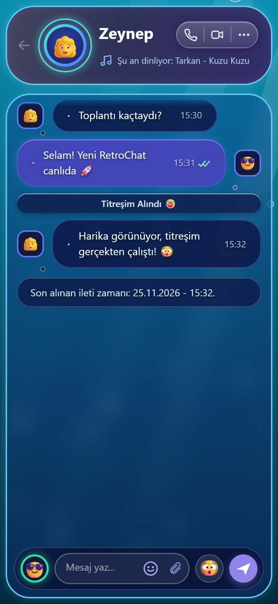

# RetroChat v1.0 — PIN-Based E2EE Real-Time Messaging, Group Chat, Calls & Mini-Games

RetroChat is a privacy-first real-time messaging, group chat, voice/video calling, and mini-game application inspired by classic MSN Messenger / BBM PIN chat—reimagined with a modern mobile glassmorphism interface. No phone numbers, no email addresses, and no traditional sign-up forms.

Every device automatically generates its own unique **8-character hexadecimal PIN**, a 32-character secret device token, and an **ECDH P-256 End-to-End Encryption (E2EE)** keypair stored locally. It runs as a live web app and installable PWA on Railway, and ships as native **Android (`.apk`)** and **iOS (`.ipa`)** packages via Capacitor.

---

## Privacy, E2EE & PIN-Only Identity

- **Random 8-Character PIN Identity:** On first launch, your device generates a random 8-character PIN (e.g., `2A8F9C3B`) and a 32-character secret token stored locally. No phone number, email, or contact-list upload is ever requested.
- **End-to-End Encryption (`crypto.js`):** Direct messages (text, replies, photos, voice/video/file URLs, GPS locations, and edits) are encrypted device-to-device using **Web Crypto ECDH (P-256) + SHA-256 KDF + AES-256-GCM**. Compare your 12-digit + 4-emoji safety fingerprint in any friend's profile to verify zero MITM.
- **Scoped Presence & Ephemeral Media:** Presence updates are delivered only to users who have your PIN in their contacts. Supports one-time view photos/videos, timed self-destructing media (3s / 5s / 10s / 30s), **delete for everyone** (including immediate server media purge), and optional **24-hour auto-delete**.
- **Encrypted Portable Backups (`extras.js`):** Export and restore your PIN identity, E2EE keys, contacts, groups, and chat history across devices as a passphrase-protected `.rcbak` file (**PBKDF2 120,000 iterations + AES-256-GCM**).

---

## Features & Walkthrough

### 1. Chats, Groups & Collapsible Online/Offline Lists
The main screen displays your profile card, PIN (with one-tap copy & native share), status / Spotify "Now Playing" bar, and collapsible **GRUPLAR**, **ONLINE**, and **OFFLINE** groups with unread counters and PWA App Icon Badges.


### 2. Real-Time Chat, Voice Notes, Reactions, Search, Pin/Edit/Forward & Physical Nudge
Inside a conversation, send E2EE text, **voice messages (🎤)**, **live emoji reactions** (`❤️ 😂 😮 😢 🙏 👍`), replies, **in-chat search (`🔍`)**, **pinned messages (`📌`)**, **message editing (`✏️`)**, **forwarding (`↪`)**, files & videos (up to 30 MB via HTTP Range streaming), GPS location cards, and disappearing media. Clicking **Nudge (🫨)** shakes the recipient's screen, plays the classic retro alert, and triggers **real physical hardware vibration** (`@capacitor/haptics` on iOS/Android, Web Vibration API on mobile browsers). Choose from **8 animated chat backgrounds** (Ocean, Beach Waves, Rain, Starry Night, Snow, Aurora, Sunset, Synthwave).



### 3. PIN, QR Code & Group Creation
Tap **＋** to add friends by 8-character PIN, scan their QR code live (`jsQR`), import a QR image, show your own QR code (`QR'IM`), or create a real-time **PIN Group Chat (`👥 GRUP`)** with custom icon, member management, and group nudges.


### 4. Themes, Night Mode, Typography & Ringtone Settings
Full-screen mobile settings (**Profile**, **Appearance**, **Notifications & Sound**, **Chats**, **Test Tools**) featuring Day/Night swipe toggle, live-preview font scaling (80%–140%), dynamic frame & theme color engine (14 presets + custom color picker), 6 synthesized ringtones, animated Emoji/Animoji avatars, PIN regeneration, and AES-256 encrypted backups.


### 5. WebRTC Voice & Video Calls (STUN/TURN + ICE Restart), Push & Mini-Games
- **Voice & Video Calls (`webrtc.js`):** Full-screen incoming/active call UI, mute, camera toggle, front/rear flip, minimize-to-chat bar, **dynamic STUN/TURN relay** (`/rtc/ice-servers`) for strict 4G/5G NATs, **bidirectional ICE Restart** with glare rollback across Wi-Fi ↔ mobile handoffs, 40s ring timeout, and call history logging.
- **Background Web Push & Native FCM (`sw.js`, `push.js`, `server/index.js`):** Receive encrypted message alerts, nudges, group invites, and incoming call notifications even when closed; supports Web Push VAPID and optional Firebase HTTP v1 (`FCM_SERVICE_ACCOUNT_JSON`) / legacy (`FCM_SERVER_KEY`) native delivery.
- **Live Multiplayer Mini-Games (`games.js`):** Play **Tic-Tac-Toe (XOX)**, **Rock-Paper-Scissors**, and **Connect 4** in real time directly from chat.

### 6. Cross-Platform Install Center (`/indir`)
Automatically detects Android, iOS, or desktop—offering one-tap WebAPK PWA install, iOS Safari "Add to Home Screen" guide, or instant web launch.


---

## Live App & Direct Downloads

- **24/7 Live Web App & PWA:** [https://retrochat-server-production.up.railway.app](https://retrochat-server-production.up.railway.app)
- **Download Center (`/indir`):** [https://retrochat-server-production.up.railway.app/indir](https://retrochat-server-production.up.railway.app/indir)
- **Direct Android Download (`.apk`):** [Download retrochat.apk](https://github.com/EmreOuzouns/RetroChat/releases/latest/download/retrochat.apk)
- **Direct iOS Download (`.ipa`):** [Download retrochat.ipa](https://github.com/EmreOuzouns/RetroChat/releases/latest/download/retrochat.ipa)

---

## Project Structure

- `server/index.js` — Node.js + WebSocket (`ws`) backend: PIN auth, atomic persistent JSON store, scoped presence, HTTP Range media/file/voice streaming (`/media/upload`, `/media/:id`), E2EE public key relay, group rooms, offline queues, Web Push + Native FCM, dynamic `/rtc/ice-servers`, WebRTC signaling, and static `www/` hosting.
- `www/index.html` & `www/css/style.css` — Mobile-first glassmorphism UI with Day/Night themes and dynamic color variables.
- `www/js/app.js` — Core chat UI, settings, themes, emoji picker, media viewer, Spotify OAuth PKCE "Now Playing", and `localStorage` + `IndexedDB` persistence.
- `www/js/crypto.js` — Web Crypto ECDH P-256 + AES-256-GCM E2EE engine and safety fingerprint generator.
- `www/js/transport.js` — Real-time WebSocket transport, auto-reconnect, outbox queue, E2EE wire encryption, and HTTP media uploads.
- `www/js/groups.js` — Multi-user PIN group creation, member management, and group messaging/nudges.
- `www/js/extras.js` — In-chat search, message pin, edit, forward, and PBKDF2 + AES-256-GCM encrypted backup/restore.
- `www/js/webrtc.js` — Peer-to-peer WebRTC voice & video calling with dynamic STUN/TURN and bidirectional ICE restart.
- `www/js/voice.js` — Cross-platform voice note recorder (Opus WebM / MP4 AAC) with HTTP upload.
- `www/js/games.js` — Real-time multiplayer engine for XOX, Rock-Paper-Scissors, and Connect 4.
- `www/js/push.js` & `www/sw.js` — PWA Service Worker (`retrochat-v7`), Web Push subscriptions, and App Icon Badge.
- `www/js/haptics.js`, `www/js/qr.js`, `www/js/native.js` — Hardware haptics, QR scanner/generator, and Capacitor Android/iOS lifecycle bridges.
- `android/`, `ios/`, `.github/workflows/build-mobile.yml`, `Dockerfile`, `railway.json` — Native Capacitor projects, automated APK/IPA CI builds, and Railway container config.

---

## How to Run & Build

### Option 1: Run the Live Server Locally
```bash
git clone https://github.com/EmreOuzouns/RetroChat.git
cd RetroChat/server
npm install
npm start
```
Open `http://localhost:3000` (or `http://localhost:3000/indir`).

Optional production environment variables on Railway:
- `DATA_DIR` — Persistent volume mount path (for `store.json` and `media/`)
- `VAPID_PUBLIC_KEY`, `VAPID_PRIVATE_KEY` — Fixed Web Push VAPID keys
- `TURN_URL`, `TURN_USERNAME`, `TURN_CREDENTIAL` — Custom TURN relay credentials
- `FCM_SERVICE_ACCOUNT_JSON` (or `FCM_SERVER_KEY`) — Native Android/iOS FCM push delivery

### Option 2: Build Native Android & iOS Apps (Capacitor)
```bash
npm install
npx cap sync
npx cap open android   # Build APK / AAB in Android Studio
npx cap open ios       # Sign & archive in Xcode (macOS)
```

---

## License

This project is licensed under the MIT License - see the [LICENSE](LICENSE) file for details.
