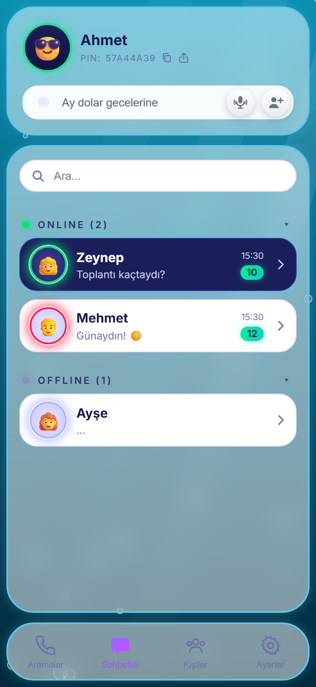
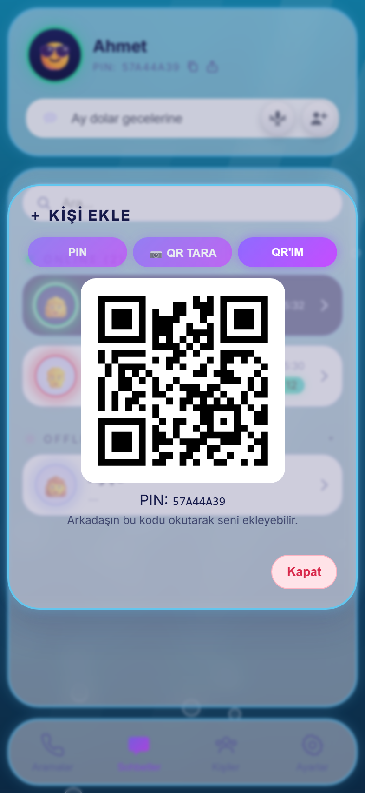
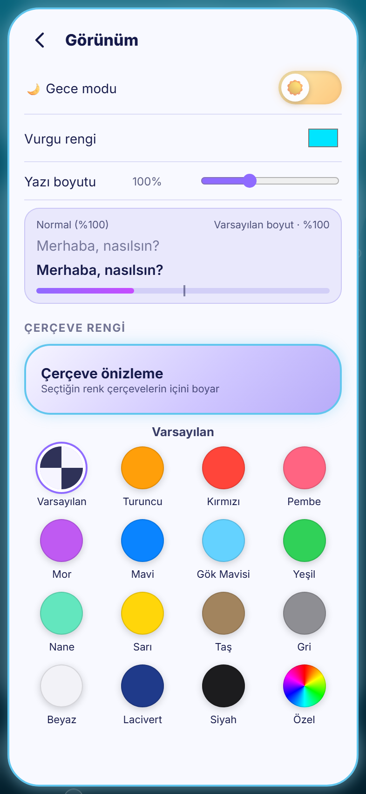
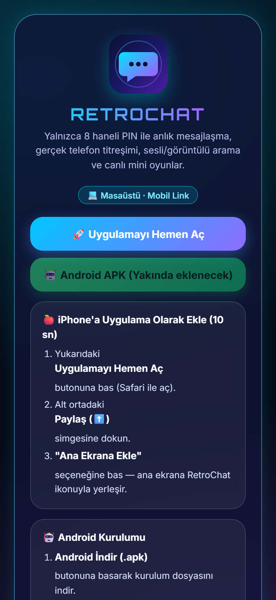

# RetroChat — PIN-Based Real-Time Messaging, Calls & Mini-Games

RetroChat is a real-time messaging, voice/video calling, and mini-game application inspired by classic MSN Messenger / BBM PIN chat—reimagined with a modern mobile glassmorphism interface. I built it to communicate with close friends quickly and privately without requiring phone numbers, email addresses, or traditional accounts.

Every device automatically generates its own unique **8-character hexadecimal PIN** paired with a local device token. It runs as a live web app and installable PWA on Railway, and is packaged as a native **Android** and **iOS** app via Capacitor with hardware haptic nudges and WebRTC calling.

---

## Privacy & PIN-Only Identity (No Email, No Phone Number)

Because RetroChat is designed for close-circle communication, there is no sign-up form, SMS verification, or email collection.

- **Random 8-Character PIN Identity:** On first launch, your device generates a random 8-character PIN (e.g., `2A8F9C3B`) and a 32-character secret device token stored locally. Nobody else can claim or impersonate your PIN.
- **No Personal Metadata:** No phone numbers, contact list uploads, email addresses, or third-party trackers.
- **Ephemeral & Disappearing Media:** Supports one-time view photos/videos, timed self-destructing media (3s / 5s / 10s / 30s), **delete for everyone**, and an optional **24-hour auto-delete** rule for inactive chats.
- **Direct Peer-to-Peer Calls:** Voice and video calls run directly over **WebRTC** (`RTCPeerConnection`), with the Railway server handling only lightweight signaling.

---

## Interface & Walkthrough

### 1. Chats & Collapsible Online/Offline Groups
The main screen displays your profile card, PIN (with one-tap copy & native share), status / Spotify "Now Playing" bar, and your friend list organized into collapsible **ONLINE** and **OFFLINE** groups with unread counters. Bottom navigation switches between **Calls**, **Chats**, **Contacts**, and **Settings**.



### 2. Real-Time Chat, Animated Backgrounds & Physical Nudge
Inside a conversation, you can send real-time text, replies, emojis, files (up to 50 MB), GPS location cards, and normal / one-time / timed media. Clicking the **Nudge (🫨)** button shakes the recipient's screen, plays the classic retro alert, and triggers **real physical hardware vibration** (`@capacitor/haptics` on iOS/Android, Web Vibration API on mobile browsers). Choose from **8 animated chat backgrounds** (Ocean, Beach Waves, Rain, Starry Night, Snow, Aurora, Sunset, Synthwave).


### 3. QR Code & PIN Contact Adding
Tap the **＋** button to add friends by typing their 8-character PIN, scanning their QR code live with the camera (`jsQR`), importing a QR image from your gallery, or showing your own QR code (`QR'IM`) so nearby friends can add you instantly.



### 4. Themes, Night Mode, Typography & Ringtone Settings
Settings are structured as full-screen mobile subpages (**Profile**, **Appearance**, **Notifications & Sound**, **Chats**). Customize Day/Night mode with a swipeable toggle, live-preview font scaling (80%–140%), an Apple Watch–style **dynamic frame & theme color engine** (14 presets + custom color picker), 6 synthesized voice/video ringtones, animated Emoji/Animoji avatars, and optional PIN regeneration.



### 5. Real-Time Voice & Video Calls (WebRTC) + Live Mini-Games
- **Voice & Video Calls (`webrtc.js`):** Full-screen incoming call screen (Accept / Decline with custom ringtone and vibration), active call overlay with mute, camera toggle, front/rear camera flip, minimize-to-chat bar, and automatic call history logging (Incoming, Outgoing, Missed, Unanswered).
- **Live Multiplayer Mini-Games (`games.js`):** Invite friends directly from chat to play **Tic-Tac-Toe (XOX)**, **Rock-Paper-Scissors**, and **Connect 4** in real time with synchronized boards and score tracking.

### 6. Cross-Platform Download Page (`/indir`)
The `/indir` route automatically detects whether the visitor is on Android, iOS, or desktop—offering one-tap Android `.apk` download, iOS "Add to Home Screen" / TestFlight setup instructions, or instant browser launch.



---

## Live App & Download

- **24/7 Live Web App & PWA:** [https://retrochat-server-production.up.railway.app](https://retrochat-server-production.up.railway.app)
- **Mobile Download & Install Page:** [https://retrochat-server-production.up.railway.app/indir](https://retrochat-server-production.up.railway.app/indir)

---

## Project Structure

- `server/index.js` — Node.js + WebSocket (`ws`) backend handling PIN authentication, persistent JSON storage (Railway Volume), offline message queuing, presence, typing indicators, read receipts, delete-for-all, live mini-game relay, WebRTC signaling, `/health` check, and static `www/` hosting.
- `www/index.html` & `www/css/style.css` — Unified mobile-first glassmorphism interface with Day/Night themes and dynamic color variables.
- `www/js/app.js` — Core chat UI, settings, themes, emoji picker, media viewer, Spotify OAuth PKCE "Now Playing", and state persistence (`localStorage` + `IndexedDB`).
- `www/js/transport.js` — Real-time WebSocket transport with automatic reconnect, outbox queue, and offline local fallback.
- `www/js/webrtc.js` — Peer-to-peer WebRTC voice & video calling engine with STUN ICE servers and full-screen call controls.
- `www/js/games.js` — Real-time multiplayer engine for XOX, Rock-Paper-Scissors, and Connect 4.
- `www/js/haptics.js` — Hardware vibration bridge (`@capacitor/haptics` → ReactNativeWebView → Web Vibration API → iOS Safari fallback).
- `www/js/qr.js` — QR code generator (`qrcode-generator`) and camera/image scanner (`jsQR`).
- `www/js/native.js` — Capacitor native lifecycle bridge (Android hardware back button, app resume reconnect, push notification permissions).
- `www/indir.html` & `www/manifest.json` — Cross-platform install page and PWA manifest.
- `android/` & `ios/` — Pre-configured Capacitor native projects with Camera, Microphone, Vibrate, Location, Notifications, and `retrochat://` deep link permissions.
- `.github/workflows/build-mobile.yml` — Automated GitHub Actions workflow for building Android APK and iOS archives.
- `Dockerfile` & `railway.json` — Containerized deployment configuration for Railway.

---

## How to Run & Build

### Option 1: Run the Live Server Locally
1. Clone the repository:
   ```bash
   git clone https://github.com/emreouzouns/retrochat.git
   cd retrochat/server
   ```
2. Install dependencies and start:
   ```bash
   npm install
   npm start
   ```
3. Open `http://localhost:3000` (or `http://localhost:3000/indir`).

### Option 2: Build Native Android & iOS Apps (Capacitor)
```bash
npm install
npx cap sync
npx cap open android   # Build APK / AAB in Android Studio
npx cap open ios       # Sign & archive in Xcode (macOS)
```
Or push to GitHub and download the compiled Android `.apk` directly from the **Actions → Build RetroChat Mobile** workflow artifacts.

---

## License

This project is licensed under the MIT License - see the [LICENSE](LICENSE) file for details.
